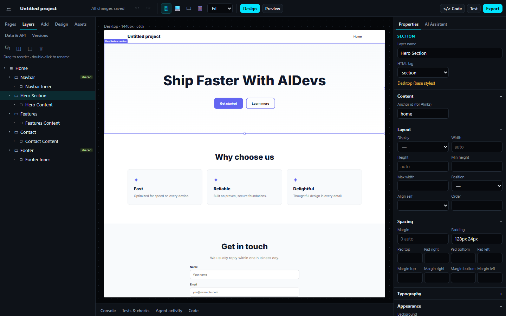
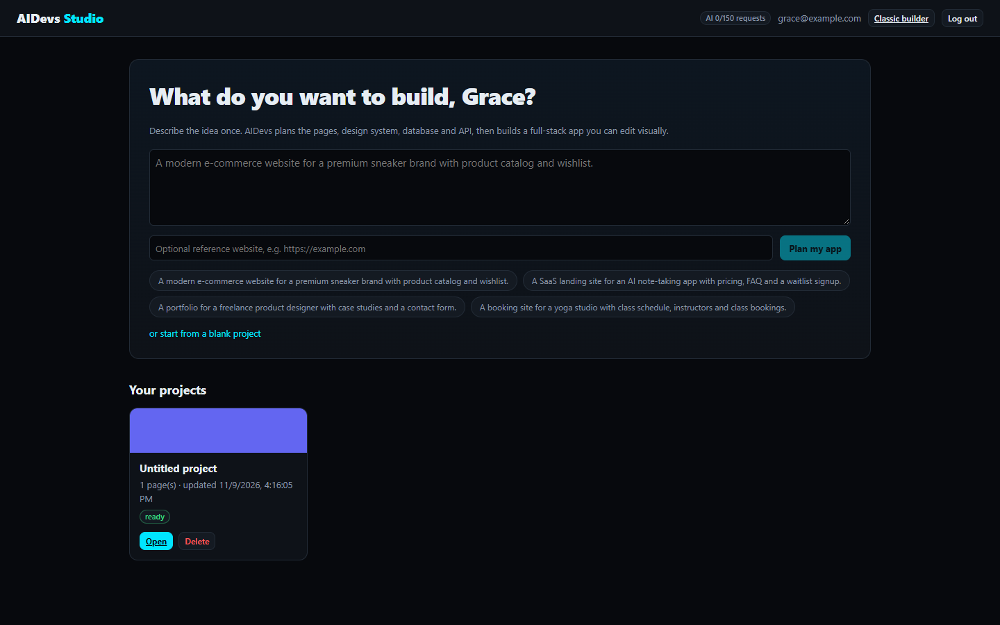
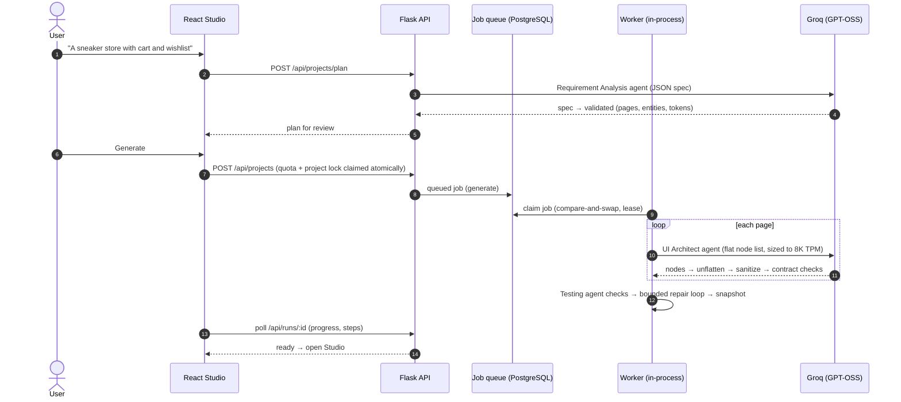
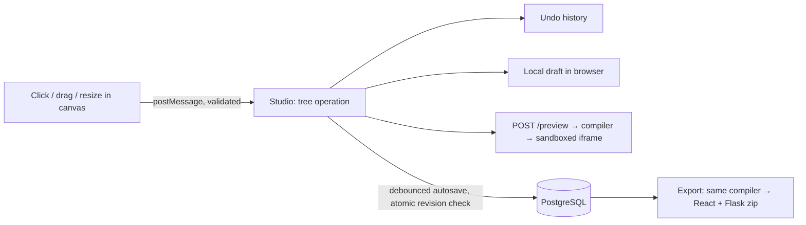
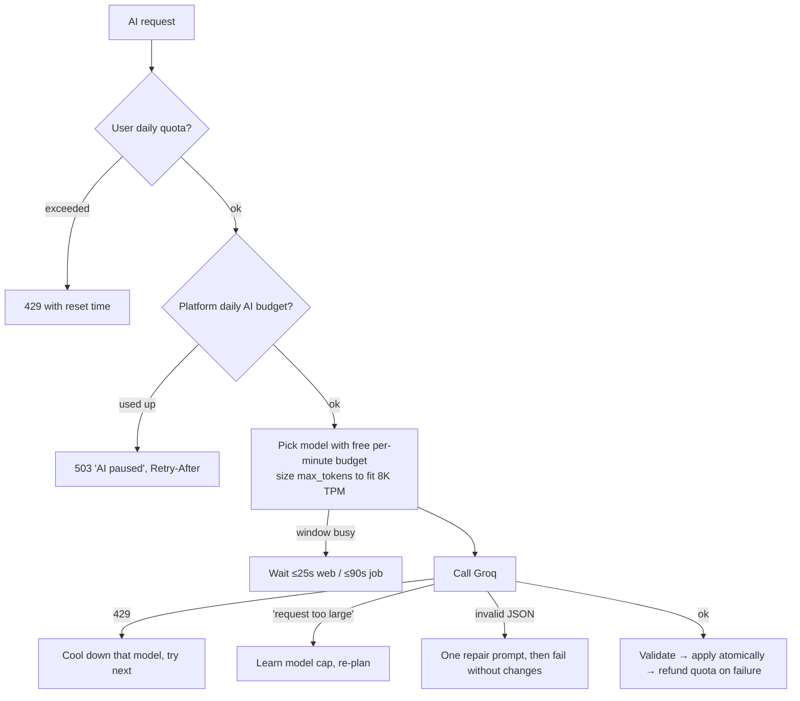
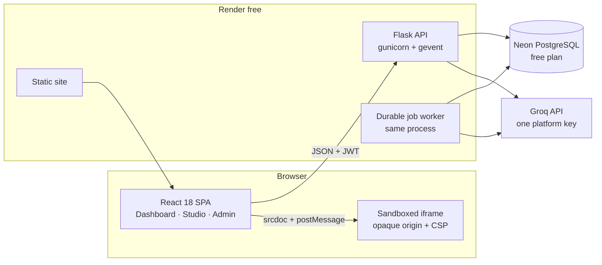

# 🤖 AIDevs 2.0 — AI Full-Stack Development Studio

Describe an app once. AIDevs plans it, designs it, builds the frontend **and** a working backend, lets you edit it
visually like a design tool, tests and auto-repairs it, and exports a project you can run anywhere.

**Idea → Specification → Design → Visual editing → Frontend → Backend → Database → Testing → Export**

> **Free to run.** AIDevs is designed to be deployed for **₹0/month** on free tiers (Render + Neon + Groq) and
> to stay usable within their limits through fair-use quotas. Free tiers are not unlimited and providers can
> change their policies — see [Free-tier limits](#-free-tier-limits-verified-2026-11-10).



## Contents
1. [Features](#-features)
2. [How it works (system flow)](#-how-it-works-system-flow)
3. [Architecture](#-architecture)
4. [Requirements](#-requirements)
5. [Run locally](#-run-locally)
6. [Deploy for free (Render + Neon + Groq)](#-deploy-for-free-render--neon--groq)
7. [Free-tier limits](#-free-tier-limits-verified-2026-11-10)
8. [Configuration](#-configuration-environment-variables)
9. [Security model](#-security-model)
10. [Testing & quality gates](#-testing--quality-gates)
11. [Operations (admin, backups, rollback)](#-operations)
12. [Project structure](#-project-structure)
13. [Known limitations & roadmap](#-known-limitations--roadmap)
14. [Contributing, security, license](#-contributing-security--license)

---

## ✨ Features

| | |
|---|---|
| **One-prompt planning** | A Requirement Analysis agent turns one sentence into a reviewable spec: audience, palette & fonts, pages, sections, data models, permissions, SEO. |
| **Reference sites** | Paste a URL; an SSRF-safe, robots.txt-aware crawler analyses structure as inspiration (copy and images stay original). |
| **Visual Studio** | Click any element: selection, resize handles, drag-to-move, inline text editing, layers (rename/reorder/group/duplicate/delete), contextual inspector, desktop/laptop/tablet/mobile overrides, undo/redo, autosave with local drafts, design tokens, assets, versions. |
| **Real code sync** | Canvas and export compile from the same validated component tree, so every visual edit is in the downloaded code (`aidevs.sourcemap.json` maps element → file → CSS class). |
| **Working backends** | Data models compile into Flask + SQLAlchemy with JWT auth, owner/admin permissions, validation, search, pagination, migrations, seed data and pytest tests. |
| **AI assistant** | Edit a selected element, or ask project-wide (“add a wishlist”) — targeted, atomic changes with an automatic snapshot. |
| **Test & auto-repair** | Deterministic checks (API contracts, links, accessibility/contrast, SEO, responsive, permissions, compile) + a bounded repair loop that only keeps fixes that reduce errors. |
| **Free-tier aware AI** | One platform Groq key, request sizing to the per-minute token window, multi-model scheduling, Retry-After handling, platform daily budget, per-user quotas, fair job scheduling. |
| **SaaS essentials** | Durable PostgreSQL job queue (retries, cancel, crash recovery), admin console, account export & deletion, structured logs, health probes, cold-start friendly UI. |



---

## 🔄 How it works (system flow)

### Generating an application



### Editing visually (no AI needed)



### AI request lifecycle (free tier)



---

## 🧱 Architecture



**Source of truth: a controlled component schema.** Each page is a validated JSON node tree
(`id, type, name, tag, props, styles{base,tablet,mobile}, children`). Every edit — canvas, inspector, layers or
AI — is a structural operation on that tree. The same compiler produces the sandboxed preview and the exported
React/CSS, which is why visual edits survive export. AI agents emit a **flat node list** that the server rebuilds
into a tree (deeply nested JSON from LLMs is unreliable; flat lists validated 4/4 on Groq vs 0/3 nested).

| Layer | Implementation |
|---|---|
| Frontend | React 18, React Router 7, CRA; Studio (`src/studio`), auth context with silent refresh, cold-start aware API client, local draft persistence |
| API | Flask 3.1 app factory; blueprints for auth, projects/pages/entities/versions/assistant, assets, admin, legacy chat |
| Agents | Requirement Analysis, UI/UX Architect + Frontend, Feature/Orchestrator, Visual Editing, Error Analysis (repair) — all validated JSON; Backend/Database and Testing are deterministic |
| AI service | `services/ai_client.py` + `ai_capacity.py` (free-tier capacity manager) + `model_registry.py` (per-task model chains) |
| Jobs | `services/jobs.py`: PostgreSQL-backed queue, CAS claims, leases, retries, timeouts, cancellation, per-project lock, fair scheduling |
| Data | SQLAlchemy 2 + Alembic (14+1 tables), SQLite locally, Neon PostgreSQL in production; assets stored in the DB |
| Compilers | `services/compiler.py` (preview), `export_frontend.py` (React + Vite 6), `export_backend.py` (Flask + SQLAlchemy + tests) |

Deep dive: [docs/ARCHITECTURE.md](docs/ARCHITECTURE.md).

---

## 📋 Requirements

**Functional:** register/login with persistent sessions · one-prompt multi-page generation · reviewable spec ·
visual editing with responsive overrides, undo/redo, autosave · AI edits of selections and project-wide features ·
generated REST backends with auth and permissions · automated checks and repair · versions & restore ·
export of a runnable React + Flask project · per-user data isolation · admin console · account export/deletion.

**Non-functional:** ₹0 hosting on free tiers · no user-supplied API keys · no secrets in the browser or exports ·
graceful behaviour under cold starts, database wake-ups and AI rate limits · no failed operation corrupts a
project · reproducible builds (pinned dependencies, lockfile) · CI-enforced tests, lint, audits and secret scanning.

**To develop locally:** Python 3.11+ · Node 18+ (20 recommended) · a free [Groq API key](https://console.groq.com/keys)
for AI features (everything else, including all automated tests, runs without one) · optional Docker for PostgreSQL tests.

---

## 🚀 Run locally

```bash
git clone https://github.com/Vedulaudayeaswar/AIDevs.git && cd AIDevs

# Backend
cd backend
python -m venv .venv
.venv\Scripts\activate                 # macOS/Linux: source .venv/bin/activate
pip install -r requirements.txt
copy .env.example .env                 # macOS/Linux: cp .env.example .env
#   set GROQ_API_KEY=gsk_...  (variable name must be UPPERCASE)
#   set JWT_SECRET_KEY to the output of: python manage.py gen-secret
#   set ADMIN_EMAILS=you@example.com
python app.py                          # http://localhost:5000 (creates & migrates a local SQLite DB)

# Frontend (new terminal, repository root)
npm ci
npm start                              # http://localhost:3000
```

Open http://localhost:3000 → **Get Started** → register → describe your app → review the plan → **Generate**.

---

## ☁️ Deploy for free (Render + Neon + Groq)

**Accounts needed (all on free plans):** GitHub, Render, Neon, Groq. This configuration only creates free
resources; whether a provider asks for card verification at sign-up is its own policy (Render documents that free
instances work without a payment method, which also means overages suspend services instead of billing).

1. **Neon** → create a project (free plan) → copy the **pooled** connection string
   (`postgresql://…-pooler.<region>.aws.neon.tech/neondb?sslmode=require`).
2. **Groq** → create an API key at console.groq.com/keys.
3. **Render** → New → **Blueprint** → select this repository. `render.yaml` creates only:
   a free **Web Service** (`plan: free`) for the API and a free **Static Site** for the frontend.
   It creates **no** Render Postgres, workers, disks or Redis.
4. When prompted, enter the secrets on `aidevs-backend`: `GROQ_API_KEY`, `DATABASE_URL` (Neon), `ADMIN_EMAILS`.
   `JWT_SECRET_KEY` is generated by Render.
5. Wait for the deploy; Render routes traffic only when `/api/health/ready` reports the database reachable,
   migrations applied and the job worker alive. Migrations run automatically and never delete data.
6. Open the static site URL, register with your admin email, visit `/admin` → **Check model availability**.

If your service names differ, update `CORS_ORIGINS` (backend) and `REACT_APP_API_URL` (frontend).
Full guide with staging/production, backups and rollback: [docs/DEPLOYMENT.md](docs/DEPLOYMENT.md).

**What runs where on the free tier:** the API and its job worker share one free instance (512 MB, 0.1 CPU).
Pending AI jobs are stored in PostgreSQL, so they survive restarts and spin-downs and resume when the
instance wakes. Uploaded images are stored in the database (Render's disk is ephemeral).

---

## 🆓 Free-tier limits (verified 2026-11-10)

| Provider | What matters | Effect on AIDevs |
|---|---|---|
| **Render free web service** | Spins down after 15 min without traffic; ~1 min to wake; 750 free instance-hours/month per workspace; 512 MB RAM / 0.1 CPU; ephemeral filesystem; no free workers or disks | First request after idle shows a “Starting the server…” banner; reads retry automatically; unsaved edits are kept in the browser |
| **Render static site** | Free; bandwidth/build minutes count against workspace allowances | Frontend always fast (CDN), even while the API sleeps |
| **Neon free** | 1 GB storage per project; 100 CU-hours/month; scale-to-zero after 5 min (wake in a few seconds); no overage billing on Free | Startup waits for wake-up; pool recycles before suspend; connection drops return 503 + Retry-After; platform upload cap 300 MB |
| **Groq free** (measured for this account via response headers) | Per model: **1,000 requests/day, 8,000 tokens/min**; qwen3.8-27b: 1,000 output tokens/min | Requests sized to fit the window; three model buckets; platform daily budget (`AI_GLOBAL_DAILY_TOKENS`); clear “AI paused” messages |

**Default fair-use limits per user** (change at runtime in `/admin`): 3 projects · 3 full AI generations/day ·
15 AI modifications/day · 10 exports/day · 50 MB uploads · 1 concurrent AI task. Failed or cancelled AI work is
refunded. Quota checks take a per-user lock, so parallel requests cannot exceed them.

> Zero cost is not guaranteed forever: providers may change free tiers. Nothing in this repository enables paid
> resources, but if you add a payment method to Render, bandwidth or build-minute overages can be billed.

Sources: [Render free tier](https://render.com/docs/free) · [Render compute plans](https://render.com/docs/compute-plans) ·
[Neon plans](https://neon.com/docs/introduction/plans) · [Neon free-plan FAQ](https://neon.com/faqs/free-plan-limits-and-quotas) ·
[Groq rate limits](https://console.groq.com/docs/rate-limits) · [Groq models](https://console.groq.com/docs/models) ·
[Groq deprecations](https://console.groq.com/docs/deprecations)

---

## ⚙️ Configuration (environment variables)

Full annotated list: [`backend/.env.example`](backend/.env.example). Key variables:

| Variable | Required | Purpose |
|---|---|---|
| `GROQ_API_KEY` | yes (AI) | Single platform key; server-side only |
| `JWT_SECRET_KEY` | production | ≥32 random chars (`python manage.py gen-secret`) |
| `DATABASE_URL` | production | Neon/PostgreSQL URL (SQLite is refused in production) |
| `CORS_ORIGINS` | production | Frontend origin(s) |
| `ADMIN_EMAILS` | recommended | Emails promoted to admin |
| `TRUST_PROXY_HOPS` | production | Proxies in front of the API (Render: 1) |
| `AI_GLOBAL_DAILY_TOKENS` | optional | Platform-wide AI budget per 24 h (pauses new AI work when used) |
| `AI_MODEL_<TASK>` | optional | Model chain per task (`REQUIREMENTS`, `FRONTEND`, `CODE_MODIFICATION`, `VISUAL_EDIT`, `ERROR_ANALYSIS`, `CHAT`) |
| `MAX_PROJECTS_PER_USER`, `AI_GENERATIONS_PER_DAY`, `AI_MODIFICATIONS_PER_DAY`, `EXPORTS_PER_DAY`, `MAX_STORAGE_MB_PER_USER`, `MAX_TOTAL_STORAGE_MB` | optional | Fair-use defaults |
| `DB_POOL_SIZE`, `DB_POOL_RECYCLE`, `DB_CONNECT_TIMEOUT`, `DB_WAIT_ATTEMPTS` | optional | Neon-friendly connection handling |
| `REACT_APP_API_URL` | frontend build | Backend URL |

---

## 🔐 Security model

- **Secrets** never reach the browser or exports; `.env` files are ignored everywhere; CI runs gitleaks and fails
  if a secret-like string reaches the frontend bundle; logs redact keys, tokens and passwords.
- **Auth:** bcrypt (cost 12); 15-min access JWTs in memory; rotating, hashed, revocable refresh tokens with reuse
  detection; logout and password change revoke sessions; brute-force rate limits that ignore spoofed
  `X-Forwarded-For`.
- **Isolation:** every project route checks ownership on the server (404 for others' data); admin API hidden (404).
- **Generated code:** previews run in an opaque-origin sandbox with a strict nonce CSP; content is schema-sanitized;
  the server **never executes** generated application code (it only compiles generated Python for syntax).
- **SSRF-safe crawler**, Pillow-verified uploads (no SVG), restricted CORS, security headers.
- Report vulnerabilities privately: [SECURITY.md](SECURITY.md).

---

## 🧪 Testing & quality gates

```bash
cd backend && pip install -r requirements-dev.txt
ruff check . && python -m pytest -q                       # SQLite
TEST_DATABASE_URL=postgresql://… python -m pytest -q      # PostgreSQL
GROQ_API_KEY=… RUN_REAL_AI=1 python -m pytest tests/real_ai -v -s   # real Groq acceptance tests (uses free quota)
cd .. && npx eslint src --max-warnings=0 && CI=true npx react-scripts test --watchAll=false && CI=true npm run build
```

Coverage includes auth/session security, cross-user isolation, durable jobs (claims, leases, retries, cancel,
restart recovery, fair scheduling), concurrency (parallel saves, versions, quota bypass attempts), migrations with
existing data on PostgreSQL, free-tier AI behaviour (429, timeouts, unavailable models, output caps, capacity
pause), database outages, export round-trips (the exported app's own tests), and real-browser Studio flows.
GitHub Actions runs everything on every pull request, plus `pip-audit`, `npm audit` and gitleaks.
Latest results: [docs/PRODUCTION_READINESS.md](docs/PRODUCTION_READINESS.md).

---

## 🛠 Operations

- **Admin console** `/admin`: health, job queue, failed AI runs, AI usage by model, rate-limit hits, limits, users.
- **Health:** `/api/health/live`, `/api/health/ready` (DB, migrations, worker), `/api/public-status` (AI capacity).
- **CLI** (`backend/manage.py`): `migrate`, `users`, `usage`, `make-admin`, `backup`/`restore` (JSON),
  `prune-tokens`, `worker`, `gen-secret`.
- **Backups:** Neon free keeps a short point-in-time restore window (check your project's history retention);
  also run `pg_dump` / `manage.py backup` regularly. **Rollback:** Render → Deploys → Rollback; schema:
  `alembic downgrade -1`. Details in [docs/DEPLOYMENT.md](docs/DEPLOYMENT.md) and
  [docs/TROUBLESHOOTING.md](docs/TROUBLESHOOTING.md).

---

## 📁 Project structure

```
backend/
  app.py, config.py, db.py, models.py   app factory, settings, Neon-aware engine, 15 tables
  migrations/                           Alembic (0001 initial, 0002 jobs/locks/settings)
  api/                                  auth, projects, assets, admin, legacy chat
  agents/studio/                        requirements, architect, editing, orchestrator, prompts
  services/                             ai_client, ai_capacity, model_registry, jobs, limits, ratelimit, repair,
                                        checks, compiler, editor_bridge.js, export_*, crawler, memory, versions,
                                        logging_setup, templates, schema
  tests/  (+ tests/real_ai)             pytest suites
  manage.py                             admin CLI
src/
  auth/, lib/api.js                     session restore, cold-start aware API client
  studio/                               Dashboard, Studio, Canvas, Layers, Inspector, Panels, Assistant, Admin, Account, Legal
  components/                           marketing site, auth screens, ServerStatus banner, classic builder
public/legal/                           Terms, Privacy, Acceptable Use, AI disclosure, Data retention (drafts)
docs/                                   ARCHITECTURE, DEPLOYMENT, TROUBLESHOOTING, PRODUCTION_READINESS, images
.github/                                CI, Dependabot, issue/PR templates
render.yaml                             zero-cost Render Blueprint
```

---

## 🚧 Known limitations & roadmap

- Free hosting sleeps: the first request after 15 idle minutes waits ~1 minute (the UI explains this).
- Free AI capacity is shared and finite; heavy usage pauses new AI tasks until the window/budget refreshes.
- One API instance with an in-process worker (by design for ₹0); scale with a dedicated worker and `REDIS_URL`
  on paid tiers if ever needed.
- No forgot-password email flow (would need an email provider); signed-in password change works.
- Generated apps are not executed on the platform (no container sandbox); their tests run in the export.
- Not yet: real-time collaboration, Git push, component marketplace, one-click deploy of generated apps.
- Legal documents are drafts and need review by a qualified lawyer before a public launch.

---

## 🤝 Contributing, security & license

[CONTRIBUTING.md](CONTRIBUTING.md) · [CODE_OF_CONDUCT.md](CODE_OF_CONDUCT.md) · [SECURITY.md](SECURITY.md) ·
[CHANGELOG.md](CHANGELOG.md) · MIT — see [LICENSE](LICENSE).

---

**Built with ❤️ by AIDevs**
